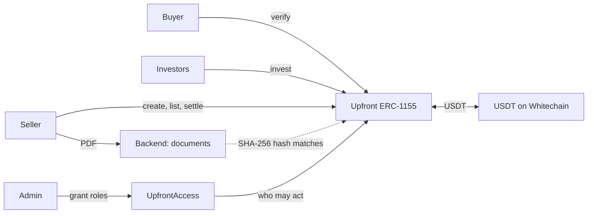

# Upfront

**Big contracts shouldn't wait for big banks.**

Upfront turns a signed project agreement into funding. A company wins a large contract, sells units of
its future repayment to investors at a discount, and gets USDT today. When it repays, one transaction
pays every investor.

- **Live app:** https://upfront.web.app
- **Demo video:** VIDEO_LINK
- **Built at:** ETHGlobal Mumbai 2026, for Whitechain Tokenize

## The problem

ABC Builder wins a $100M data centre project from a global tech company. Before it gets paid, it needs
money for land, materials, machinery, and thousands of workers. Banks are slow, want collateral, and
depend on a few lenders. Ordinary investors can't take part at all.

## How it works

1. **Seller** (the builder) uploads the signed agreement. The file stays offchain, and its SHA-256 hash
   goes onchain.
2. **Buyer** (the client) checks the agreement and verifies it from its own wallet.
3. **Seller** lists units of the repayment at a discount.
4. **Investors** buy units. USDT reaches the seller and units reach the investor in one transaction.
5. **Seller** does the work, gets paid by the client, and clicks Settle before the due date. One
   transaction pays 1 USDT per unit to whoever holds the units.

An **Admin** approves who can take part, but can't move funds or change an existing receivable.

| | The pitch | Testnet demo |
|---|---|---|
| Repaid by the due date | $100,000,000 | 10.00 USDT = 10 units |
| Investors pay the builder today (3% discount) | $97,000,000 | 9.70 USDT |
| Investors' profit | $3,000,000 | 0.30 USDT |



The chain is the source of truth. The backend only stores agreements, and money still moves if it's
down.

## How we used Whitechain

Everything settles in real test USDT on Whitechain Sepolia (chain ID 1874), through two verified smart
contracts: [`UpfrontAccess.sol`](contracts/src/UpfrontAccess.sol) and
[`Upfront.sol`](contracts/src/Upfront.sol).

**Why this needs onchain stablecoin settlement on Whitechain:** Selling units needs the right to
repayment and the money to change hands at the same moment, and repayment must reach whoever holds the
units then, even if they were resold. A bank transfer can't move money and a transfer-restricted token
in one atomic step, or pay every holder set by a smart contract in one transaction. USDT on Whitechain
can.

| Contract | Address |
|---|---|
| `UpfrontAccess` | [`0x7f8dF0d47e0265Df7E1f8AF1d091757B193cECd2`](https://explorer.testnet.whitechain.io/address/0x7f8dF0d47e0265Df7E1f8AF1d091757B193cECd2) |
| `Upfront` | [`0x50eD2278EBCAA43eE213596881157a80e5041BC9`](https://explorer.testnet.whitechain.io/address/0x50eD2278EBCAA43eE213596881157a80e5041BC9) |

**USDT settlement:** [one transaction paying both investors](https://explorer.testnet.whitechain.io/tx/0x54ec787e22d5c058def448bec01c57bfe7ccb9c50362ae54b8a94c6b079ca5b0).
Every step of that run is linked in [`DEMO_TXS.md`](DEMO_TXS.md).

## Rules enforced by the smart contracts

| Rule | How |
|---|---|
| Allowlist | Only wallets with the right role can create, verify, list, or invest |
| Delivery versus payment | USDT and units swap in one transaction, or nothing moves |
| Investor cap | No wallet can hold more units than the cap |
| Transfer restrictions | Units move only to approved investors, never to the seller or buyer, and only before the due date |
| Seller's units locked | Unsold units leave the seller only through `invest` |
| No self-dealing | The seller and buyer can't invest in their own receivable |
| One document, one active receivable | The same agreement hash can't back two |
| Maturity | Only the seller can settle, only before the due date. After that, anyone can mark it Defaulted |
| Buyer verification | Only the named buyer can set the Verified tag, and it can't be undone |

Every transfer passes through one check in `_update`, so batches and approved operators follow the same
rules. The tests cover 100% of lines in both smart contracts.

## What the Admin can and can't do

The Admin can grant and revoke roles. It can't move USDT, move anyone's units, or change an existing
receivable, because no function in `Upfront` checks for the Admin. It could give itself the Seller role
and create a new receivable, but that touches nobody else's money.

## Limitations

- KYB is simulated: the Admin grants roles by hand.
- Verification is a tag, not a gate. An unverified receivable can be funded, and investors see it has no
  tag.
- Investors rely on the seller to repay, with no collateral. The client's payment happens outside
  Upfront, and a production version would route it through escrow.
- The smart contracts can't confirm the work was done, only that the client verified the agreement.
- One payment on one due date, with no milestones. Real construction deals pay in stages.
- Settlement pays every holder in one transaction, so it suits a small number of holders, and one
  holder who can't receive USDT would stop it. Production would use batches and a fallback claim.
- There's no late payment: after the due date, the seller can't settle. Freeze, KYB expiry, and pause
  aren't built.
- The cap is per wallet, so one person with two approved wallets can hold twice as much.
- Document uniqueness is exact-file only, so the buyer's review is the real check.
- Documents are stored by our backend and are public to anyone with the hash, so the demo uses sample
  agreements only.
- A real deployment needs licensing like India's TReDS platforms, and a legal agreement behind the token.
- The Admin is a single key, where production would use a multisig.
- Not audited, testnet only.

## Run locally

You need Node 20+ and [Foundry](https://getfoundry.sh).

```bash
git clone --recursive https://github.com/AdityaBirangal/Upfront.git
cd Upfront

# Smart contracts
cd contracts
forge test
anvil                                                                       # in its own terminal
forge script script/DeployLocal.s.sol --rpc-url http://127.0.0.1:8545 --broadcast

# Backend
cd ../backend && npm install && cp .env.example .env && npm run start:dev

# Frontend
cd ../frontend && npm install && cp .env.example .env && npm run dev
```

The local deploy uses mock USDT and anvil's default accounts. Account 0 is Admin, 1 Seller, 2 Buyer,
3 and 4 Investors, and 5 the Outsider.

### Getting test USDT on Whitechain Sepolia

The faucet only gives WBT, so swap WBT for USDT through the WWBT/USDT pool, using `exactInputSingle` on
`SwapRouter02` at `0xe208cC685cD95D56E8ec6DEC9816476567fc6962`, fee `3000`. About 0.3 WBT bought 22
USDT when we did it.

## Team

Aditya Birangal and Niranjan Girhe.
