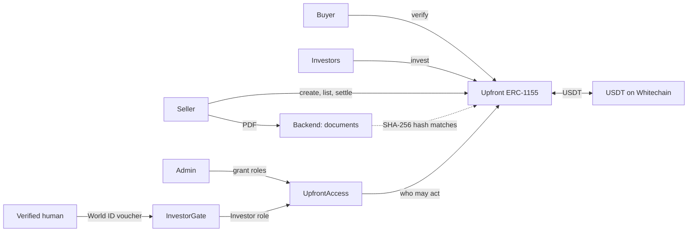

# Upfront

**Big contracts shouldn't wait for big banks.**

Upfront turns a signed project agreement into funding. A company wins a large contract, sells units of
its future repayment to investors at a discount, and gets USDT today. When it repays, one transaction
pays every investor.

- **Live app:** https://upfront.web.app
- **Demo video:** VIDEO_LINK
- **Built at:** ETHGlobal Mumbai 2026, for Whitechain Tokenize and World ID

## The problem

ABC Builder wins a $100M data centre project from a global tech company. Before it gets paid, it needs
money for land, materials, machinery, and thousands of workers. Banks are slow, want collateral, and
depend on a few lenders. Ordinary investors can't take part at all.

## Business case

**Customer:** businesses anywhere that have won a large contract from a strong client and must pay for
the work before they get paid. We'd start with construction and data centre projects.

**Why they'd use Upfront:** they need money before the client pays. Upfront lets them raise it against
the signed contract, from many investors, in minutes once units sell, without pledging collateral.

**Why investors would use it:** they can buy small units of a deal they could never reach before, read
the agreement, see whether the client verified it, and resell to other approved investors.

**How Upfront earns:** a planned fee of 0.5% of the money raised, paid by the seller when a receivable is
funded. On a $90M raise, that's $450,000. The fee isn't in the smart contracts yet.

**Why this market is real:** selling receivables is already a large, proven business.
[Global factoring passed €4 trillion in 2025](https://bcrpub.com/?p=152600), and India's RBI-regulated
TReDS platforms let smaller businesses sell invoices once the buyer has accepted them. Upfront applies
that idea to large project contracts, with onchain settlement and resale between approved investors.

**Future scope:** client-paid escrow, milestone payments, and real KYB.

## How it works

1. **Seller** (the builder) uploads the signed agreement. The file stays offchain, and its SHA-256 hash
   goes onchain.
2. **Buyer** (the client) checks the agreement and verifies it from its own wallet.
3. **Seller** lists units of the repayment at a discount.
4. **Investors** buy units. USDT reaches the seller and units reach the investor in one transaction.
5. **Seller** does the work, gets paid by the client, and clicks Settle before the due date. One
   transaction pays 1 USDT per unit to whoever holds the units.

An **Admin** approves who can take part, but can't move funds or change an existing receivable.
Investors can also [join by themselves with World ID](#how-we-used-world-id), once per human.

| | The pitch | Testnet demo |
|---|---|---|
| Repaid by the due date | $100,000,000 | 10.00 USDT = 10 units |
| Investors pay the builder today (10% discount) | $90,000,000 | 9.00 USDT |
| Investors' profit | $10,000,000 | 1.00 USDT |



The chain is the source of truth. The backend only stores agreements, and money still moves if it's
down.

## How we used Whitechain

Everything settles in real test USDT on Whitechain Sepolia (chain ID 1874), through verified smart
contracts: [`UpfrontAccess.sol`](contracts/src/UpfrontAccess.sol),
[`Upfront.sol`](contracts/src/Upfront.sol), and [`InvestorGate.sol`](contracts/src/InvestorGate.sol).

**Why this needs onchain stablecoin settlement on Whitechain:** Selling units needs the right to
repayment and the money to change hands at the same moment, and repayment must reach whoever holds the
units then, even if they were resold. A bank transfer can't move money and a transfer-restricted token
in one atomic step, or pay every holder set by a smart contract in one transaction. USDT on Whitechain
can.

| Contract | Address |
|---|---|
| `UpfrontAccess` | [`0x7f8dF0d47e0265Df7E1f8AF1d091757B193cECd2`](https://explorer.testnet.whitechain.io/address/0x7f8dF0d47e0265Df7E1f8AF1d091757B193cECd2) |
| `Upfront` | [`0x50eD2278EBCAA43eE213596881157a80e5041BC9`](https://explorer.testnet.whitechain.io/address/0x50eD2278EBCAA43eE213596881157a80e5041BC9) |
| `InvestorGate` | [`0x63152Da7dd72fc81bfB65d36f75D29f7Dd6f37B9`](https://explorer.testnet.whitechain.io/address/0x63152Da7dd72fc81bfB65d36f75D29f7Dd6f37B9) |

**USDT settlement:** [https://explorer.testnet.whitechain.io/tx/0x43cbea02dd197d9293a21e2b5e677a84eac77a141ea746a6e47776e1c728f072](https://explorer.testnet.whitechain.io/tx/0x43cbea02dd197d9293a21e2b5e677a84eac77a141ea746a6e47776e1c728f072).
Every step of that run is linked in [`DEMO_TXS.md`](DEMO_TXS.md).

## How we used World ID

**The trust moment: can this wallet join as an investor?** Each receivable caps how much one investor
can hold, so large deals stay spread across many people. That cap is per wallet, so without a check, one
person could use several wallets to get around it.

**Why Proof of Human is the minimum:** the cap needs to know this is one person, not who they are. We
don't need a name, age, or nationality, so Proof of Human is enough, and the investor shares nothing
else.

**How it works:** World ID has no verifier on Whitechain, so the proof is checked offchain and the
one-human rule is enforced onchain.

1. The wallet opens IDKit with the `proofOfHuman` preset, and the wallet address is the signal.
2. The backend confirms the proof is for this wallet, this action, and Proof of Human, then verifies it
   with World's API.
3. The backend signs a short-lived voucher for that wallet. It sends no transactions and holds no funds.
4. The wallet calls [`InvestorGate.join`](contracts/src/InvestorGate.sol). The gate checks the voucher,
   refuses a nullifier it has seen, and grants the Investor role.

| Path | Result |
|---|---|
| Verified human, first wallet | Joins as an investor, with no Admin involved |
| Same human, second wallet | Refused: "This person already has an investor wallet" |
| Verification cancelled | The wallet still can't invest |
| Wallet that never verified | Can't invest, and can ask an Admin instead |

World ID is optional. Without it the app works as before, and an Admin can still grant the role.

**What's next:** a regulated deal may need more than uniqueness, such as screening investors against
sanctions rules. We intend to use World ID's nationality check as one input to that, without handling
anyone's document data. It's still in preview, so today we use Proof of Human, which is the minimum the
cap needs. Nationality alone wouldn't make Upfront OFAC compliant, because sanctions also depend on
listed people and location, so production would need full sanctions screening.

**Limits:** the demo uses World's simulator, so its proofs are staging proofs, not real humans. In our
tests every simulator identity counted as the same human, so only one wallet can join at a time. If you
try the live demo after someone else joined, you'll be refused, which is the rule working. An Admin can
reset the gate from the Roles page so the demo can run again. That removes the wallets that joined and
lets the same humans rejoin, so "one human, one wallet" holds between resets. It gives an Admin no new
power over investors, because an Admin can already add or remove any investor by hand. Whitechain
can't check the proof itself, so the gate trusts the backend's signing key: if that key leaked, someone
could add fake investors, but couldn't touch funds or any other role. The gate must be an admin of
`UpfrontAccess`, because that's the only role that can grant `INVESTOR_ROLE`. It's safe because it can
only add investors through `join` and remove wallets that joined through it, and it can't be upgraded.

[Our notes for World](WORLD_FEEDBACK.md) cover how integration went.

## Rules enforced by the smart contracts

| Rule | How |
|---|---|
| Allowlist | Only wallets with the right role can create, verify, list, or invest |
| Delivery versus payment | USDT and units swap in one transaction, or nothing moves |
| Investor cap | No wallet can hold more units than the cap |
| Transfer restrictions | Units move only to approved investors, never to the seller or buyer, and only before the due date |
| Seller's units locked | Unsold units leave the seller only through `invest` |
| No self-dealing | The seller and buyer can't invest in their own receivable |
| One document, one active receivable | The same agreement hash can't back two |
| Maturity | Only the seller can settle, only before the due date. After that, anyone can mark it Defaulted |
| Buyer verification | Only the named buyer can set the Verified tag, and it can't be undone |

Every transfer passes through one check in `_update`, so batches and approved operators follow the same
rules. The tests cover 100% of lines in `Upfront` and `UpfrontAccess`.

## What the Admin can and can't do

The Admin can grant and revoke roles. It can't move USDT, move anyone's units, or change an existing
receivable, because no function in `Upfront` checks for the Admin. It could give itself the Seller role
and create a new receivable, but that touches nobody else's money.

## Limitations

- KYB is simulated: the Admin grants roles by hand.
- Verification is a tag, not a gate. An unverified receivable can be funded, and investors see it has no
  tag.
- Investors rely on the seller to repay, with no collateral. The client's payment happens outside
  Upfront, and a production version would route it through escrow.
- The smart contracts can't confirm the work was done, only that the client verified the agreement.
- One payment on one due date, with no milestones. Real construction deals pay in stages.
- Settlement pays every holder in one transaction, so it suits a small number of holders, and one
  holder who can't receive USDT would stop it. Production would use batches and a fallback claim.
- There's no late payment: after the due date, the seller can't settle. Freeze, KYB expiry, and pause
  aren't built.
- The cap is per wallet. World ID stops one human joining twice through the gate, but "one human, one
  wallet" doesn't cover wallets an Admin added by hand.
- Document uniqueness is exact-file only, so the buyer's review is the real check.
- Documents are stored by our backend and are public to anyone with the hash, so the demo uses sample
  agreements only.
- A real deployment needs licensing like India's TReDS platforms, and a legal agreement behind the token.
- The Admin is a single key, where production would use a multisig.
- Not audited, testnet only.

## Run locally

You need Node 20+ and [Foundry](https://getfoundry.sh).

```bash
git clone --recursive https://github.com/AdityaBirangal/Upfront.git
cd Upfront

# Smart contracts
cd contracts
forge test
anvil                                                                       # in its own terminal
forge script script/DeployLocal.s.sol --rpc-url http://127.0.0.1:8545 --broadcast

# Backend
cd ../backend && npm install && cp .env.example .env && npm run start:dev

# Frontend
cd ../frontend && npm install && cp .env.example .env && npm run dev
```

The local deploy uses mock USDT and anvil's default accounts. Account 0 is Admin, 1 Seller, 2 Buyer,
3 and 4 Investors, and 5 the Outsider.

World ID stays off locally until you set the `WORLD_*` values and keys in `backend/.env` and
`VITE_WORLD_*` in `frontend/.env`. See the `.env.example` files.

### Getting test USDT on Whitechain Sepolia

The faucet only gives WBT, so swap WBT for USDT through the WWBT/USDT pool, using `exactInputSingle` on
`SwapRouter02` at `0xe208cC685cD95D56E8ec6DEC9816476567fc6962`, fee `3000`. About 0.3 WBT bought 22
USDT when we did it.

## Team

Aditya Birangal and Niranjan Girhe.

## License

[MIT](LICENSE)
